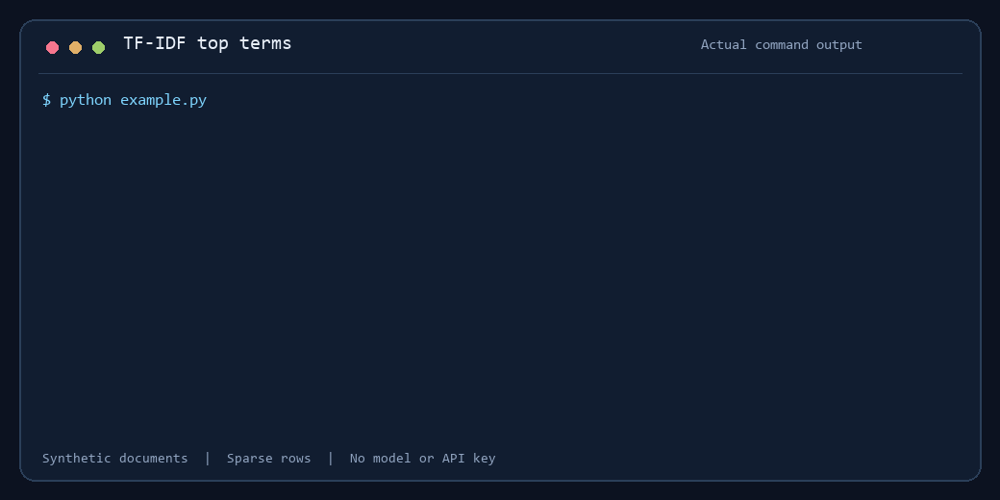

# TF-IDF top terms

This repository contains a small `top_terms` helper for ranking the nonzero entries in one sparse TF-IDF row. The helper uses only the Python standard library and does not import scipy or scikit-learn. It works with scipy CSR matrices and `csr_array` objects through a sparse one-row slice, so it never densifies the matrix or modifies the input.



Use it to inspect document features, explain a retrieval result, or spot noisy
terms before feeding text into a larger search or ML pipeline. Duplicate entries
are combined, ties are stable, and invalid scores fail with a clear error.

## Quickstart

Pass a two-dimensional CSR-style matrix and feature names in the same column order:

```python
from tfidf_weights import top_terms

# matrix is a scipy CSR matrix or csr_array.
# feature_names is matrix-column aligned, for example from get_feature_names_out().
terms = top_terms(matrix, feature_names, row_index=0, top_n=5)
print(terms)
```

The result is a list of `(term, weight)` pairs, ordered by descending weight and then ascending column index for ties. It contains up to `top_n` nonzero terms; a row with fewer nonzero terms returns fewer results.

## Optional sklearn example

The core helper has no third-party installation requirement. To run the real `example.py` demonstration, install its optional dependencies in the environment where you run it:

```text
git clone https://github.com/smgpulse007/getweights_tfidf.git
cd getweights_tfidf
python -m venv .venv
```

On Windows, run:

```powershell
.\.venv\Scripts\python.exe -m pip install scipy scikit-learn
.\.venv\Scripts\python.exe example.py
```

On macOS or Linux, run:

```sh
.venv/bin/python -m pip install scipy scikit-learn
.venv/bin/python example.py
```

The example creates a `TfidfVectorizer`, calls `get_feature_names_out()`, and passes the resulting CSR matrix and feature names to `top_terms`.

The GIF is rendered from captured output of the real example and test commands,
using synthetic documents. To rebuild it, install the optional `Pillow` package
and run `python scripts/record_demo.py`. The captured output and source hashes are
kept in [the recording metadata](docs/demo-recording.json).

## Inputs and validation

- `matrix` must use CSR format, have a two-dimensional shape, and support `matrix[row_index:row_index + 1]`. The sliced row must expose sparse `indices` and `data` sequences. Convert other SciPy sparse layouts with `matrix.tocsr()` first.
- `feature_names` must have exactly one entry per matrix column.
- `row_index` and `top_n` must be non-bool, nonnegative integers. `row_index` must be within the matrix row bounds.
- Sparse column ids must be valid matrix columns.
- Every sparse weight, including the combined value for duplicate column entries, must be finite and nonnegative.

Invalid dimensions, feature counts, sparse ids, and weights raise actionable `TypeError` or `ValueError` exceptions; an out-of-bounds row raises `IndexError`. Duplicate sparse entries are summed, and zero scores are omitted.

## Tests

The standard-library tests use a fake CSR row interface, including a row that raises if code tries to densify it. Optional scipy/scikit-learn integration tests are skipped when those packages are unavailable.

```text
python -m unittest discover -s tests -v
```

## Historical snippet

The original `return_weights` file is intentionally retained unchanged. Its snippet is useful as historical context, but it has several limitations: it depends on externally defined `pd`, `vocab`, `original_vocab`, `vector`, and `tfidf_vec`; it requires pandas; constructing a dictionary silently overwrites duplicate sparse column entries; it returns values looked up in `original_vocab` rather than term/weight pairs; and its print executes when the snippet is run.

`top_terms` is scoped to ranking one finite, nonnegative sparse row. It does not fit a vectorizer, normalize scores, densify matrices, or provide package installation metadata.
